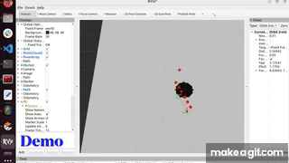
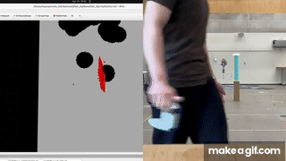

# Perception-Informed Autonomous Navigation for a Monopedal Hopping Robot 
(Instructions are for simulation)

This project simulates **Hopcopter** — a Crazyflie-based monopedal hopping robot — in Gazebo Harmonic. A ROS2 pipeline integrates LiDAR point-cloud processing, OMPL RRT* global path planning, and a multi-criteria local planner that scores and refines candidate landing zones in real time, enabling fully autonomous obstacle-aware navigation. An optional natural-language goal interface (powered by Claude) lets users command the robot in plain English.

## Demo

**Simulation** — [Local planner explanation (YouTube)](https://youtu.be/Yvn6zSlEApQ)



**Hardware** — [Full hardware demo (YouTube)](https://youtu.be/_PuOxqvgZJw)



## Authors

**Zwe Min Htet Aung** — zweminhtetaung@gmail.com

---

## Architecture Overview

```
┌─────────────┐       ┌──────────────────────┐       ┌────────────┐
│ Elevation   │──────▶│  ballistic_planner   │──────▶│  hopcopter │
│ Map (2.5D)  │       │  (A* Global Planner)  │       │ (Control)  │
└─────────────┘       └──────────────────────┘       └────────────┘
                             ▲
                             │
                      ┌──────┴───────┐
                      │  /goal_pose  │
                      │              │
                      ├──────────────┤
                      │ Option A:    │
                      │  ros2 topic  │
                      │  pub --once  │
                      ├──────────────┤
                      │ Option B:    │
                      │  NLP Goal    │
                      │  Interface   │
                      └──────────────┘
```

**Pipeline:**
1. **ballistic_planner** — Reads the 2.5D elevation map, listens for `/goal_pose`, and runs a hopping-aware A* search to compute a global path of physically feasible parabolic hops. Publishes a set of waypoints (Marker id=400) and each hop's takeoff (`hopcopter_msgs/HopPlan`).
2. **hopcopter** — Follows the waypoints one hop each. At every apex it re-solves the planned takeoff from where and how fast the robot is about to land, and commands the landing attitude that launches it.

---

## Prerequisites

- Ubuntu 22.04
- ROS2 Humble
- Gazebo Harmonic
- System packages:
  ```bash
  sudo apt-get install libboost-program-options-dev libusb-1.0-0-dev python3-colcon-common-extensions
  sudo apt-get install ros-humble-motion-capture-tracking ros-humble-tf-transformations
  sudo apt-get install ros-humble-ros-gzharmonic
  ```
- OMPL (Open Motion Planning Library)
- PCL (Point Cloud Library): `sudo apt-get install libpcl-all-dev`
- Python packages: `pip3 install cflib scipy`

---

## Installation

```bash
# Clone the repository
git clone <repo-url> ~/CrazySim
cd ~/CrazySim

# Build the ROS2 workspace
cd ros2_ws
source /opt/ros/humble/setup.bash
colcon build
source install/setup.bash
```

---

## Running the Simulation

The 2.5D ballistic hopping A* planner (C++ port of
`hopcopter-ballistic-planning/`) plans **once** per goal on a known elevation
map published by `elevation_map_publisher`, and does not use a LiDAR bridge or
TF broadcaster. **7 terminals**; source every terminal as above. To build the
map from the LiDAR instead, see
[Running with the LiDAR map](#running-with-the-lidar-map-hopcopter_perception).

### Terminal 1 — Start Gazebo (low-wall world)

```bash
cd ~/CrazySim/crazyflie-firmware
bash tools/crazyflie-simulation/simulator_files/gazebo/launch/sitl_singleagent.sh -m crazyflie -x 0 -y 0 -w crazysim_low_wall
```

The `crazysim_low_wall` world is the default world without the chair/prius,
plus a 0.4 m wall at world x ∈ [2.5, 2.7] matching the published elevation map
(`wall.x_min` / `wall.x_max`). This is 1.3 m farther out than the Python reference
`maps/low_wall.py`, which would put it at world x ∈ [1.2, 1.4].

### Terminal 2 — Launch cflib Server

```bash
cd ~/CrazySim/ros2_ws
ros2 launch crazyflie launch.py backend:=cflib gui:=False
```

### Terminal 3 — IMU Bridge

```bash
ros2 run ros_gz_bridge parameter_bridge \
  /cf_0/imu@sensor_msgs/msg/Imu@gz.msgs.IMU
```

### Terminal 4 — Odometry Bridge

```bash
ros2 run ros_gz_bridge parameter_bridge \
  "/cf_0/odom@nav_msgs/msg/Odometry[gz.msgs.Odometry"
```

### Terminal 5 — Elevation Map Publisher

Publishes the known 2.5D map (`grid_map_msgs/GridMap` on `/elevation_map`,
5×5 m @ 0.1 m, origin (−0.5, −2.5); scenario selectable via the `scenario`
parameter: `low_wall` or `flat`, or one of the worlds in [Other worlds](#other-worlds)):

```bash
ros2 run elevation_map_publisher elevation_map_publisher_node
```

### Terminal 6 — Ballistic Motion Planner

Plans once per `/goal_pose` and publishes the waypoints on
`/ballistic_trajectory` (Marker id=400; per-waypoint z = the target apex of the
hop that lands there) and each hop's takeoff on `/ballistic_hop_plan`
(`hopcopter_msgs/HopPlan`). By default it plans for the real robot: a vertical
push of at most 4 J/kg per hop and no landing tilted more than 20°
(`search.momentum_aware`; see `CHANGELOG.md`):

```bash
ros2 run ballistic_motion_planner ballistic_planner_node
```

### Terminal 7 — Hopcopter Controller

```bash
ros2 run hopping_robot hopcopter
```

### Start and Send a Goal

Click **Play** in the Gazebo GUI; the robot begins hopping in place. Then send
the low-wall scenario goal (Python GOAL (4.5, 2.5) → world (4.0, 0.0)):

```bash
ros2 topic pub --once /goal_pose geometry_msgs/msg/PoseStamped \
"{header: {frame_id: 'world'}, pose: {position: {x: 4.0, y: 0.0, z: 0.0}, orientation: {w: 1.0}}}"
```

### Other worlds

Four more worlds mirror the maps in `hopcopter-ballistic-planning/maps/`. Each Gazebo world
(Terminal 1, `-w`) has a matching elevation map scenario (Terminal 5); run the two together.
Each map is shifted so its Python `START` sits at world (0, 0), where the robot spawns, so
Terminal 1 keeps `-x 0 -y 0`. The goal is the Python `GOAL` in world coordinates.

| World | Terminal 1 `-w` | Terminal 5 `--ros-args -p scenario:=` | Goal (x, y) |
|---|---|---|---|
| Stairs | `crazysim_stairs` | `stairs` | (4.0, −2.0) |
| 30° slope | `crazysim_slope_30deg` | `slope_30deg` | (4.25, −2.0) |
| Cliff gap | `crazysim_cliff_gap` | `cliff_gap` | (9.5, 0.5) |
| Maze | `crazysim_maze` | `maze` | (14.0, 0.0) |
| Lilypads | `crazysim_lilypads` (with `-z 3.4`) | `lilypads` | (11.75, 0.0) |
| Slanted pads | `crazysim_slanted_pads` (with `-z 3.4`) | `slanted_pads` | (15.85, 0.0) |

Copy-paste commands for each world (Terminals 2–4, 6 and 7 are the same for every world).
Send the goal after pressing **Play** and waiting for the warm-up hops.

#### Stairs

```bash
# Terminal 1 (in ~/CrazySim/crazyflie-firmware)
bash tools/crazyflie-simulation/simulator_files/gazebo/launch/sitl_singleagent.sh -m crazyflie -x 0 -y 0 -w crazysim_stairs

# Terminal 5 (in ~/CrazySim/ros2_ws)
ros2 run elevation_map_publisher elevation_map_publisher_node --ros-args -p scenario:=stairs

# Goal
ros2 topic pub --once /goal_pose geometry_msgs/msg/PoseStamped \
"{header: {frame_id: 'world'}, pose: {position: {x: 4.0, y: -2.0, z: 0.0}, orientation: {w: 1.0}}}"
```

#### 30° slope

```bash
# Terminal 1 (in ~/CrazySim/crazyflie-firmware)
bash tools/crazyflie-simulation/simulator_files/gazebo/launch/sitl_singleagent.sh -m crazyflie -x 0 -y 0 -w crazysim_slope_30deg

# Terminal 5 (in ~/CrazySim/ros2_ws)
ros2 run elevation_map_publisher elevation_map_publisher_node --ros-args -p scenario:=slope_30deg

# Goal
ros2 topic pub --once /goal_pose geometry_msgs/msg/PoseStamped \
"{header: {frame_id: 'world'}, pose: {position: {x: 4.25, y: -2.0, z: 0.0}, orientation: {w: 1.0}}}"
```

#### Cliff gap

```bash
# Terminal 1 (in ~/CrazySim/crazyflie-firmware)
bash tools/crazyflie-simulation/simulator_files/gazebo/launch/sitl_singleagent.sh -m crazyflie -x 0 -y 0 -w crazysim_cliff_gap

# Terminal 5 (in ~/CrazySim/ros2_ws)
ros2 run elevation_map_publisher elevation_map_publisher_node --ros-args -p scenario:=cliff_gap

# Goal
ros2 topic pub --once /goal_pose geometry_msgs/msg/PoseStamped \
"{header: {frame_id: 'world'}, pose: {position: {x: 9.5, y: 0.5, z: 0.0}, orientation: {w: 1.0}}}"
```

#### Maze

```bash
# Terminal 1 (in ~/CrazySim/crazyflie-firmware)
bash tools/crazyflie-simulation/simulator_files/gazebo/launch/sitl_singleagent.sh -m crazyflie -x 0 -y 0 -w crazysim_maze

# Terminal 5 (in ~/CrazySim/ros2_ws)
ros2 run elevation_map_publisher elevation_map_publisher_node --ros-args -p scenario:=maze

# Goal
ros2 topic pub --once /goal_pose geometry_msgs/msg/PoseStamped \
"{header: {frame_id: 'world'}, pose: {position: {x: 14.0, y: 0.0, z: 0.0}, orientation: {w: 1.0}}}"
```

#### Lilypads

```bash
# Terminal 1 (in ~/CrazySim/crazyflie-firmware): -z spawns above the 2 m start platform
bash tools/crazyflie-simulation/simulator_files/gazebo/launch/sitl_singleagent.sh -m crazyflie -x 0 -y 0 -z 3.4 -w crazysim_lilypads

# Terminal 5 (in ~/CrazySim/ros2_ws)
ros2 run elevation_map_publisher elevation_map_publisher_node --ros-args -p scenario:=lilypads

# Goal
ros2 topic pub --once /goal_pose geometry_msgs/msg/PoseStamped \
"{header: {frame_id: 'world'}, pose: {position: {x: 11.75, y: 0.0, z: 0.0}, orientation: {w: 1.0}}}"
```

`lilypads` has no Python reference map. Two 2.0 m platforms 10 m apart with 20 cylindrical pads
(1.8–2.2 m tall, r 0.35–0.75 m) between them, over ground at 0. It plans in about 4 s.

#### Slanted pads

```bash
# Terminal 1 (in ~/CrazySim/crazyflie-firmware): -z spawns above the 2 m start platform
bash tools/crazyflie-simulation/simulator_files/gazebo/launch/sitl_singleagent.sh -m crazyflie -x 0 -y 0 -z 3.4 -w crazysim_slanted_pads

# Terminal 5 (in ~/CrazySim/ros2_ws)
ros2 run elevation_map_publisher elevation_map_publisher_node --ros-args -p scenario:=slanted_pads

# Goal
ros2 topic pub --once /goal_pose geometry_msgs/msg/PoseStamped \
"{header: {frame_id: 'world'}, pose: {position: {x: 15.85, y: 0.0, z: 0.0}, orientation: {w: 1.0}}}"
```

`slanted_pads` has no Python reference map. It has the lilypads start platform (2.0 m) and a
goal platform at x 15.1–16.6. Between them are seven 1 × 1 m pads sloped 12–20°, with every top
within 2.0 ± 0.2 m, over ground at 0:
- six pads in two columns (y 0.3…1.3 and −1.3…−0.3) that face each other, each low on its inner
  edge;
- a last pad C at y 0, low toward the start.

Consecutive pads are 1.9 m apart in x, so two pads in one column are 2.8 m apart, past the
longest hop. The plan zigzags start → L1 → R1 → L2 → R2 → L3 → R3 → C → goal: 9 hops of 0.8–2.3 m
with landing tilts up to 19°. It plans in about 4 s.

`stairs` and `cliff_gap` are edited from the Python maps so the planner can
plan them for the robot (see `CHANGELOG.md`); `slope_30deg` and `maze` match them. The maze's
poles sit in a 3 m corridor between two side walls, and its 0.5 m wall spans the full width, so
the robot has to hop among the poles and over the wall rather than around them. `cliff_gap` takes
about 20 s to plan and `maze` about 7 s; the robot hops in place meanwhile.

The planner logs the hop table (takeoff angle, speeds, injected energy per
hop) and writes `ballistic_path_*.csv` / `ballistic_hops_*.csv` to
`data/data_ballistic_planner/` for comparison against
`data/data_hopcopter/landing_points_*.csv`.

### Running with the LiDAR map (`hopcopter_perception`)

The same planner and controller, but on a map the robot builds itself (docs/lidar_mapping_plan.md):
the simulated Livox Mid-360 and its IMU go through FAST-LIO to `lidar_elevation_mapper`, which
publishes `/elevation_map`. The scenario's known map goes on `/elevation_map_known`, as the
ground truth the LiDAR map is scored against. The robot is held at its spawn pose until FAST-LIO
is up, then dropped as at Play.

**Prerequisites** (once): FAST-LIO and the Livox driver are overlays outside this repo, built in
`~/ws_livox` (`livox_ros_driver2`, which FAST-LIO needs for its messages) and `~/fastlio_ws`
(`FAST_LIO_ROS2`, commit `18418bc`). In every terminal, source in this order, then build:

```bash
source /opt/ros/humble/setup.bash
source ~/ws_livox/install/setup.bash
source ~/fastlio_ws/install/setup.bash
cd ~/CrazySim/ros2_ws && colcon build && source install/setup.bash
```

**Before each launch**, make sure nothing from an earlier run is still running:
`pgrep -af hopcopter_perception` must print nothing (stop leftovers with `pkill -f
hopcopter_perception`). A leftover `lidar_sim_adapter` sends FAST-LIO every scan twice, and its
pose diverges. `lio_anchor` refuses to release the robot while a sensor topic has two publishers,
and the mapper warns above 11 scans/s.

**Five terminals** (each sourced as above):

```bash
# 1. Gazebo: -H holds the robot until the pipeline releases it (add -z 3.4 for lilypads)
cd ~/CrazySim/crazyflie-firmware
bash tools/crazyflie-simulation/simulator_files/gazebo/launch/sitl_singleagent.sh -m crazyflie -x 0 -y 0 -w crazysim_low_wall -H

# 2. cflib server
cd ~/CrazySim/ros2_ws && ros2 launch crazyflie launch.py backend:=cflib gui:=False

# 3. The LiDAR pipeline: bridges, adapter, FAST-LIO, anchor, mapper, known map (replaces Terminals 3-5)
ros2 launch hopcopter_perception lidar_mapping.launch.py scenario:=low_wall

# 4. Planner
ros2 run ballistic_motion_planner ballistic_planner_node

# 5. hopcopter
ros2 run hopping_robot hopcopter
```

Then:
1. Press **Play**.
2. The robot hangs for ~1.5 s while FAST-LIO initializes. `lio_anchor` prints
   `Released the robot`, and the robot drops.
3. It makes its warm-up hops while the map fills in.
4. Send the goal as usual.

A goal the LiDAR has not seen yet gets a **frontier plan** (the reachable measured cell nearest
it). The planner **replans** when the map invalidates the rest of the plan, when it can do better,
or when the robot holds. For a replan it publishes a DELETE, the robot hops in place, and it plans
from there. Each replan is logged with its reason to `data/data_ballistic_planner/replans_*.csv`.
For goals on platforms above the sensor (slope_30deg, cliff_gap), do a look-out hop first:
`ros2 param set /hopcopter desired_rel_z 1.4`, then back to `0.8`, then send the goal.

Launch arguments:
- `scenario:=<world>`: the known map; the planner's map takes its extent.
- `pose_source:=lio` (default) or `gazebo`: the mapper on FAST-LIO, or on Gazebo's pose (a mocap
  lab; no FAST-LIO, released after 1 s).
- `mapping:=false`: no LiDAR map; the known map on `/elevation_map`, i.e. the known-map mode with
  one launch file in place of Terminals 3–5.
- `imu_acc_limit_g:=32 imu_gyro_limit_dps:=2000`: clip the LiDAR IMU at the real sensor's range.
- `bridge:=false`: replay a bag of `/clock /cf_0/lidar/points /cf_0/lidar_imu /cf_0/odom`
  instead of running Gazebo.

After a run (system `python3` is enough):

```bash
ros2 run hopcopter_perception lio_report.py        # FAST-LIO against Gazebo (data/data_lio/)
ros2 run hopcopter_perception map_report.py        # LiDAR map against the known map
ros2 run hopcopter_perception plot_elevation_map.py   # newest map snapshot -> PNG
```

Results on 2026-11-07, all with FAST-LIO, the planner and hopcopter on the LiDAR map:

| World | Goal | Result | FAST-LIO RMSE | Map error median / p95 |
|---|---|---|---|---|
| low_wall | (4, 0) and back | both reached in 4 of 4 runs, no hold | 1.8–2.0 cm | 0.5–0.7 / 1.7–1.8 cm |
| flat | (4, 0), then (1, 1.5) | both reached in 2 of 2 runs | 1.7–2.3 cm | 0.6–0.7 / 1.5–1.6 cm |
| lilypads | (11.75, 0) | reached via 2 frontier plans | 1.3–2.6 cm | 0.4–0.5 / 1.5 cm |
| maze | (14, 0) | reached in 1 of 2 runs, via 3 frontier plans; the other landed on the 0.3 m wall and fell | 4.1–6.7 cm (drift along the corridor) | 0.5–0.7 / 1.7–2.6 cm |
| slope_30deg | (4.25, −2) | reached via 3 frontier plans (look-out hop) | 1.7–2.5 cm | 0.4–0.6 / 1.3–1.7 cm |
| cliff_gap | (9.5, 0.5) | reached in 1 of 2 runs (look-out hop; the other fell from the far platform's rim) | 2.0–2.5 cm | 0.5–0.6 / 1.6–1.8 cm |
| stairs | (4, −2) | not reached: no 0.3 m tread is landable on the LiDAR map (the robot waits beside the stairs) | 3.1 cm | — |

Runs counted from the final planner settings (`standable.lidar_edge_margin` 0.1). The two falls
(the maze's wall, cliff_gap's rim) are landings left 0.05–0.15 m from a real edge. A margin of 0.2
prevents them but leaves lilypads' smallest pads only their centre cell, and its partial-map plan
then fails. docs/lidar_mapping_plan.md ("Status") has the trade-off.

### Offline Mapper Check

Flies a simulated Mid-360 along each world's known-map plan, builds the map, and scores it
against the known map: height error away from edges (median ≤ 2 cm, 95th percentile ≤ 5 cm), no
false obstacles away from edges, and no upper bound under the terrain that a neighbour does not
cover. About a minute; exits 1 on a failure. `--pose-noise <deg>` adds a LIO-like attitude error.

```bash
ros2 run hopcopter_perception mapper_check
```

### Offline Parity Check

Verifies the C++ port against the Python reference planner (no ROS graph
needed):

```bash
ros2 run ballistic_motion_planner ballistic_parity_test
```

Compare with the Python side (`cd ~/CrazySim/hopcopter-ballistic-planning &&
python main.py low_wall`): waypoints, per-hop physics, and search counters
should match.

### Offline Plan Check

Plans 15 cases with the node's defaults and checks every landing's tilt, the
plans `docs/follow_planner_plan.md` expects, and that the controller could fly
each hop with real speeds (leg angle and push capacity, η 0.71–0.85). Then five
partial LiDAR maps: unseen shadows and pits (no landing there), a wall widened
by the mapper (no landing on it), an unmeasured start (refused), and a frontier
plan. About two minutes; exits 1 on a failure:

```bash
ros2 run ballistic_motion_planner ballistic_plan_check
```
